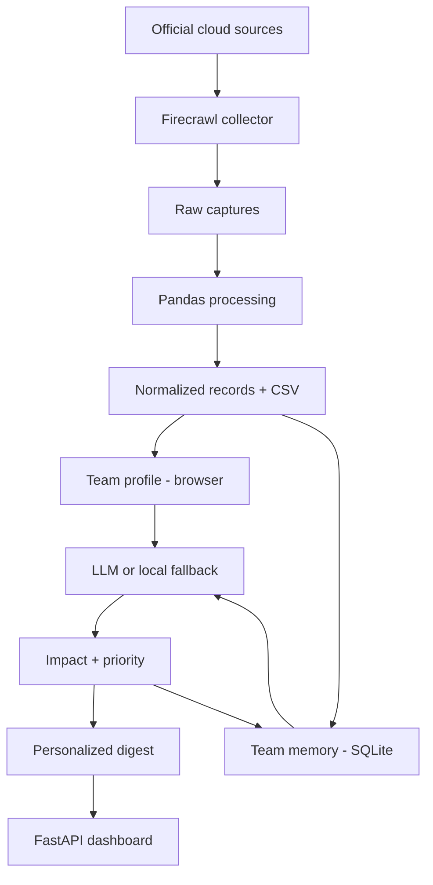

# Architecture

Modules: collector, processor, memory, analyzer, digest, API routes. Raw captures are saved under data/raw; normalized CSV under data/processed; memory database is in memory/.

In demo mode the first box is replaced by built-in illustrative samples. Live mode cuts each official page into release-note entries (splitter.py), keeping a whole-page capture only when a page cannot be split. The Ask page (qa.py) answers questions from the collected updates and memory. Every request body is validated with Pydantic models.
